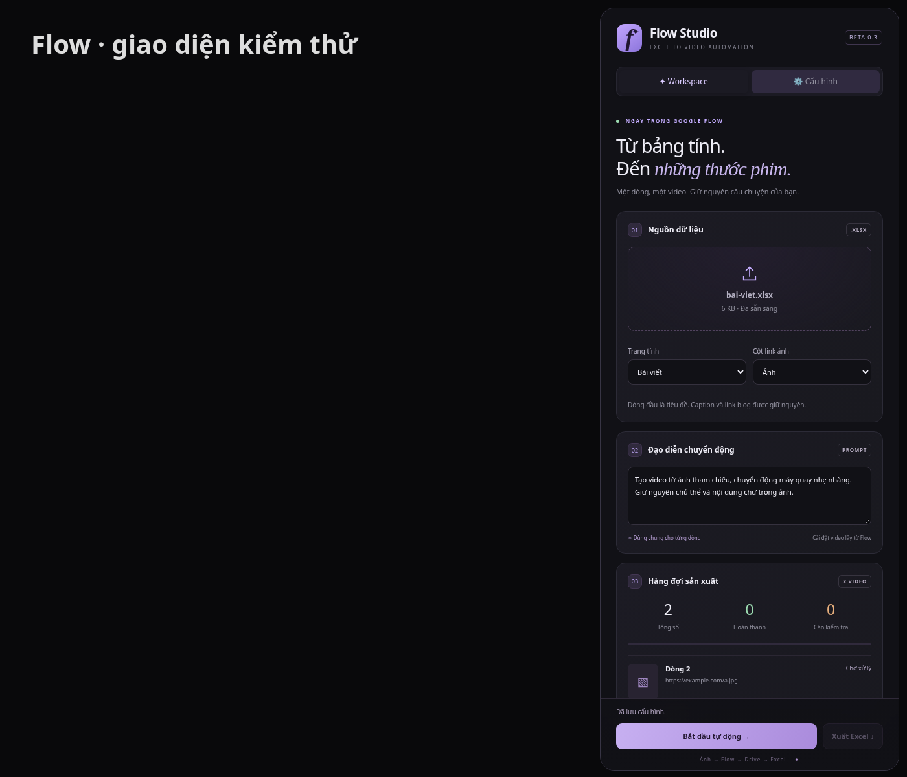

# Flow Studio · Excel → Flow → Drive

Extension Chrome Manifest V3, phiên bản **0.3.0 thử nghiệm**. Bảng điều khiển giao diện tối, tím nhạt hiển thị **ngay bên phải trang https://flow.google.com/**. Không mở trang làm việc riêng. Bấm biểu tượng extension để ẩn/hiện bảng; khi đang ở trang khác, biểu tượng mở Flow.



## Cài đặt bản đã đóng gói

1. Tải [flow-extension.zip](https://github.com/Thanhtn1801/baitapb1/raw/refs/heads/main/flow-extension.zip), giải nén vào một thư mục cố định.
2. Mở `chrome://extensions`, bật Developer mode, chọn **Load unpacked** và chọn thư mục `flow-extension` có `manifest.json`.
3. Nếu nâng cấp từ bản cũ, thay nội dung thư mục cũ bằng bản mới và bấm **Reload** ở extension. Giữ cùng thư mục cài để ID extension không đổi; OAuth redirect gắn với ID đó.
4. Tải lại tab Flow đang đăng nhập. Extension chỉ hoạt động trên `flow.google.com`; không yêu cầu mật khẩu Google/Facebook.

## Cấu hình một lần

### Google Drive

Trong tab **Cấu hình** của bảng điều khiển:

- Nhập **OAuth Client ID**, không nhập Client Secret. Dùng Client loại **Web application** hỗ trợ `launchWebAuthFlow`.
- Bật Drive API trong dự án Google Cloud và thêm chính xác URL hiển thị trong hướng dẫn OAuth của extension vào **Authorized redirect URIs**. Không đoán URL: lấy giá trị thực tế trong extension sau khi cài.
- Cấu hình OAuth consent screen; với ứng dụng Testing, thêm tài khoản sử dụng vào Test users. Nếu ứng dụng đang bật hạn chế không cho implicit token flow, phải dùng một client được cấu hình tương thích; bản này dùng `response_type=token`.
- Bấm **Kết nối Google Drive**, đăng nhập và cấp quyền `drive.file`. Client ID là thông tin công khai; token chỉ lưu trong `chrome.storage.session`, không lưu vào source hay file Excel. Khi hết hạn, kết nối lại.
- Thư mục nhận video có thể để trống để lưu tại My Drive. Quyền `drive.file` không cho phép truy cập mọi thư mục có sẵn: nếu gặp 404/quyền truy cập, để trống hoặc dùng thư mục ứng dụng được phép truy cập.
- Link trả về là link tệp Drive; extension không tự bật chia sẻ công khai.

### Nhận diện Flow

Ảnh chụp màn hình không cung cấp cấu trúc DOM, nên không thể đảm bảo các selector mặc định phù hợp mọi tài khoản Flow. Bản này có công cụ nhận diện bằng cách bấm trực tiếp, thay vì buộc người dùng viết CSS:

1. Mở dự án và chọn chế độ **Video**, xuất **x1**. Chọn model, tỉ lệ và thời lượng mong muốn trực tiếp trong Flow; extension giữ các lựa chọn này. Việc tạo video có thể tiêu tốn tín dụng tài khoản.
2. Thêm thử một ảnh vào vùng soạn thảo.
3. Trong **Cấu hình**, bấm **Nhận diện nút trên Flow**. Bảng điều khiển sẽ ẩn tạm thời và hướng dẫn chọn 5 phần tử: ô prompt, nút +, ảnh đính kèm, nút xóa ảnh, nút tạo video.
4. Các lần bấm trong chế độ nhận diện chỉ ghi nhớ phần tử; không thực hiện thao tác xóa hay tạo. Nhấn Esc để hủy.
5. Mục nâng cao cho phép sửa selector ô chọn file, mục tải ảnh, vùng hiển thị Video/x1 và video kết quả nếu cần. Nếu Flow yêu cầu thao tác bổ sung như crop/xác nhận ảnh hoặc có shadow DOM riêng, adapter hiện tại có thể dừng và cần cập nhật; không giả lập thành công.

## Chạy hàng đợi

1. Thả Excel **.xlsx**, tối đa 20 MB. Dòng đầu là tiêu đề. Chọn trang tính và cột chứa link ảnh.
2. URL ảnh có thể là giá trị ô hoặc hyperlink Excel. Cần URL HTTPS trực tiếp trả về JPEG, PNG, WebP hoặc GIF; link bài đăng Facebook/ảnh hết hạn/trang cần đăng nhập được báo lỗi. Ảnh tối đa 20 MB. Không tự lấy ảnh từ HTML bài đăng.
3. Nhập prompt chung. Caption và link blog không bị dùng làm prompt hay sửa đổi.
4. Bấm **Bắt đầu tự động**, cấp quyền truy cập các host ảnh và CDN video Google. Không chạy tác vụ tạo khác cùng lúc trong dự án này; giữ tab Flow mở.
5. Với mỗi dòng: tải ảnh → xóa ảnh cũ nếu có → tải ảnh vào Flow → chờ ảnh đính kèm hiện ra → điền prompt → bấm tạo đúng một lần → chờ video mới → tải từng phần lên Drive → ghi link kết quả.
6. Khi hoàn thành toàn bộ, Excel được xuất tự động. Có thể bấm **Xuất Excel** để lấy kết quả một phần. Chỉ ô ảnh của các dòng đã có video Drive được thay thế; dòng chưa hoàn thành giữ nguyên.

Lỗi ở một dòng sẽ dừng hàng đợi để tránh lặp lại lỗi/tốn tín dụng. Bấm thử lại sau khi xử lý lỗi. Nếu video đã tạo nhưng upload thất bại, thử lại chỉ tải Drive, không tạo video lại. Với video Blob URL, không đóng/tải lại dự án trước khi tải Drive vì URL có thể hết hiệu lực. Reload extension không tự gửi lại dòng đang tạo: yêu cầu kiểm tra Flow trước để tránh tạo trùng. Dừng extension không hủy được tác vụ render đã gửi cho Flow.

Hàng đợi và file đầu vào lưu trong IndexedDB của extension để khôi phục khi tải lại; OAuth Client ID và selector lưu trong `chrome.storage.local`. Không gửi dữ liệu đến server riêng. Video/ảnh được gửi đến Google theo quy trình bạn yêu cầu. Chưa có cơ chế tự dọn dữ liệu; gỡ extension sẽ xóa dữ liệu cục bộ. Không hỗ trợ `.xls`, macro hoặc đảm bảo bảo toàn các tính năng Excel nâng cao không được ExcelJS hỗ trợ; giữ bản gốc.

## Phát triển và kiểm chứng

Node.js 24, npm 11:

```sh
npm ci --cache /tmp/flow-npm
npm run build
npm test
npm run test:browser
```

`test:browser` dùng Chromium tại `/usr/bin/chromium` (có thể đổi đường dẫn trong các test khi chạy trên hệ điều hành khác).

- Test Excel xác minh đọc hyperlink và vòng đọc/ghi giữ caption, blog, dòng chưa xử lý và trang tính khác.
- Test background mô phỏng Drive API: xác minh Content-Range, offset, kết quả cuối, xóa token khi 401 và từ chối HTML giả ảnh.
- Test Chromium dùng **trang mô phỏng và Chrome API giả lập**: panel nhúng, nhập/khôi phục Excel, xác thực cấu hình, đưa ảnh vào form, điền prompt, chỉ gửi tạo một lần, chọn video mới thay vì video cũ, xóa ảnh dòng trước, dừng không gửi lại và nhận diện nút không gây thao tác tạo.
- Chưa xác minh đăng nhập OAuth thật, tạo video thật hoặc upload vào tài khoản Drive thật. Chromium của môi trường phát triển bị chính sách quản trị chặn cài extension giải nén; không vượt qua chính sách đó. Các test mô phỏng không thay thế kiểm thử tích hợp trên trình duyệt của bạn.

Đây là luồng tự động hóa thử nghiệm có cấu hình ban đầu, **chưa cam kết chạy trọn vẹn trên tài khoản Flow thực tế**. Khi DOM hoặc quy trình upload của Flow thay đổi, cần nhận diện lại hoặc cập nhật adapter. Không dựa vào API nội bộ không được tài liệu hóa.
